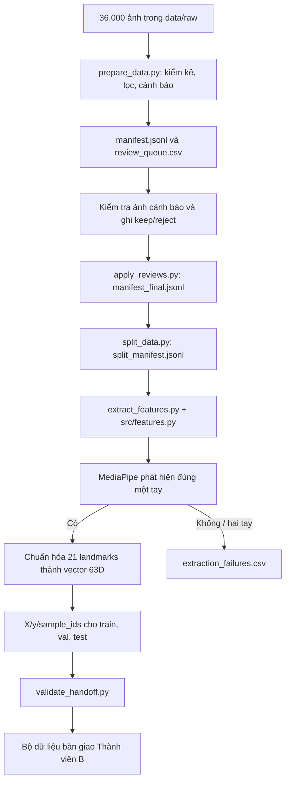

# TÀI LIỆU THÀNH VIÊN A — CHUẨN BỊ DỮ LIỆU VÀ TRÍCH XUẤT ĐẶC TRƯNG

**Đồ án:** Hệ thống nhận diện 34 ký hiệu bàn tay tĩnh (Static Hand Gesture Recognition)  
**Vai trò:** Thành viên A — kiểm kê dữ liệu, làm sạch, chia tập, trích xuất đặc trưng và kiểm tra bàn giao  
**Công nghệ:** Python, OpenCV, NumPy, MediaPipe Hands  
**Đầu ra:** Bộ dữ liệu đặc trưng 63 chiều cho Thành viên B huấn luyện mô hình  
**Mốc kết quả:** 13/11/2026 — dựa trên các lệnh và thống kê đã chạy thực tế

---

## 1. Mục tiêu và phạm vi công việc

Đầu vào ban đầu là các ảnh bàn tay đã được tổ chức theo nhãn và người thực hiện ký hiệu (*Participant*). Thành viên A không trực tiếp huấn luyện mô hình phân loại cuối cùng; nhiệm vụ chính là biến dữ liệu ảnh thô thành **một bộ dữ liệu có thể kiểm tra, truy vết và sử dụng nhất quán** cho việc huấn luyện, đánh giá.

Những việc cụ thể gồm:

1. Kiểm kê dữ liệu, xác định ảnh thuộc phạm vi 34 nhãn.
2. Kiểm tra tính hợp lệ của file, thông tin nhãn, người thực hiện và ảnh trùng lặp.
3. Đánh giá các chỉ số chất lượng ảnh, đưa ảnh đáng nghi vào hàng đợi kiểm tra.
4. Áp dụng quyết định giữ/loại để hoàn thành làm sạch dữ liệu (*Cleaning*).
5. Chia dữ liệu theo Participant thành Train, Validation và Test.
6. Dùng MediaPipe trích xuất landmarks rồi chuẩn hóa thành vector 63 chiều.
7. Kiểm tra dữ liệu bàn giao cho Thành viên B, gồm số chiều, kiểu dữ liệu, nhãn và nguy cơ rò rỉ dữ liệu.

**Giới hạn:** Kết quả kiểm tra *PASS* ở bước bàn giao xác nhận tính hợp lệ của bộ dữ liệu theo các quy tắc đã lập trình; nó **không** đồng nghĩa mô hình đã đạt độ chính xác tốt, cũng không bảo đảm tất cả nhãn gốc đều hoàn toàn chính xác.

## 2. Dữ liệu đầu vào và 34 nhãn

Dữ liệu gốc gồm **36.000 ảnh**, trong đó **34.000 ảnh** thuộc 34 nhãn mục tiêu. Các nhãn được giữ là:

```text
0 1 2 3 4 5 6 7 8 9
A B C D E F G H I K L M N O P Q R S T U V W X Y
```

Hai nhãn **J và Z** nằm ngoài phạm vi nhận diện ký hiệu tĩnh của phiên bản này và bị loại ngay tại bước kiểm kê.

Tập dữ liệu có 10 Participant (P1 đến P10). Cấu trúc ảnh gốc được truy cập bằng đường dẫn tương đối như:

```text
data/raw/
├── A/
│   ├── P1_A_001.jpg
│   └── ...
├── D/
│   └── P8_D_730.jpg
└── ...
```

Đường dẫn trong manifest luôn tương đối với `data/raw/`, ví dụ `D/P8_D_730.jpg`. Mỗi ảnh được quản lý bằng một `sample_id`, `relative_path`, `label`, `participant_id` và các thông tin phục vụ kiểm tra chất lượng.

## 3. Sơ đồ quy trình tổng thể



Điểm quan trọng là **`prepare_data.py` không dùng MediaPipe trong quy trình chính thức**. MediaPipe được dùng để hỗ trợ xem ảnh trong công cụ kiểm tra riêng và dùng chính thức tại bước `extract_features.py`. Nhờ vậy không cần chạy mô hình phát hiện tay cho toàn bộ ảnh hai lần.

---

## 4. Bước 1 — `scripts/prepare_data.py`: Kiểm kê và lọc ban đầu

### 4.1. Đầu vào và đầu ra

- **Đầu vào:** `data/raw/`.
- **Đầu ra chính:** `manifests/manifest.jsonl`, `manifests/review_queue.csv`, `manifests/inventory_summary.json`, `manifests/duplicate_groups.json`, `manifests/auto_approved_images.csv`.

Lệnh thực hiện phiên bản chính thức:

```powershell
.\.venv311\Scripts\python.exe scripts/prepare_data.py --data-dir data/raw --blur-threshold 20 --contrast-threshold 15 --bright-threshold 230 --overwrite-review-queue
```

`--overwrite-review-queue` cho phép tạo lại hàng đợi review, **ghi đè quyết định cũ**. Chỉ dùng tham số này khi chủ động bắt đầu lại bản cleaning.

### 4.2. Các phép kiểm tra

**a. Cấu trúc thư mục, tên file và nhãn.** Chương trình xác định nhãn từ thư mục, Participant và nhãn trong tên file; kiểm tra định dạng và tính nhất quán. Các nhãn J/Z được đánh dấu `out_of_scope`.

**b. Khả năng đọc file.** OpenCV đọc ảnh để xác nhận file hợp lệ và tính chỉ số chất lượng. Ảnh không đọc được bị loại theo quy tắc bắt buộc.

**c. Phát hiện trùng lặp.** SHA-256 được dùng ở mức file và pixel ảnh. Với các ảnh có pixel trùng chính xác và cùng nhãn, chương trình giữ một bản đại diện; các bản trùng dư bị loại. Một nhóm trùng có thể xuất hiện ở nhiều Participant, vì vậy thông tin trùng được lưu lại để kiểm soát việc chia tập.

**d. Đo chất lượng ảnh.** Ba chỉ số quan trọng:

| Chỉ số | Cách hiểu | Điều kiện cảnh báo chính thức |
|---|---|---|
| Blur (`blur_score`) | Độ biến thiên Laplacian trên ảnh xám; điểm thấp cho thấy ảnh có khả năng mờ | `< 20` |
| Contrast (`contrast_std`) | Độ lệch chuẩn mức sáng của ảnh xám | `< 15` |
| Brightness (`brightness_mean`) | Độ sáng trung bình ảnh xám | `< 45` (quá tối), `> 230` (quá sáng) |
| Kích thước | Cạnh ngắn của ảnh | `< 128 px` |

**Các ngưỡng ở đây là ngưỡng *cảnh báo*, không phải tự động loại mọi ảnh.** Giá trị Blur phụ thuộc cách tính và tiền xử lý nên không có nghĩa là một ngưỡng chất lượng chung cho mọi bộ dữ liệu.

### 4.3. Ý nghĩa ba trạng thái

| `review_status` | Ý nghĩa | Có vào dữ liệu sử dụng ngay không? |
|---|---|---|
| `approved` | Ảnh vượt qua kiểm tra tự động | Có, tạm thời |
| `review_needed` | Ảnh có dấu hiệu cần đánh giá thêm | Chưa |
| `rejected` | Ảnh vi phạm điều kiện loại bắt buộc như ngoài phạm vi, không đọc được, bản trùng dư | Không |

Một ảnh có thể đồng thời có nhiều `reason_codes`. `warning_counts` đếm cảnh báo **trên cả ảnh đã bị loại**, do đó số lượt cảnh báo không nhất thiết bằng số ảnh `review_needed`.

### 4.4. Vì sao chọn ngưỡng Blur 20, Contrast 15?

Các ngưỡng ban đầu được điều chỉnh sau khi quan sát ảnh mẫu và kết quả nhận diện landmarks bằng MediaPipe trong **công cụ kiểm tra**, không phải bằng cách thay thế toàn bộ bước cleaning bằng MediaPipe.

- Nhóm ảnh Contrast **15–20** được quan sát là vẫn rõ; trong mẫu kiểm tra 50 ảnh thuộc nhóm này, MediaPipe phát hiện tay ở 50 ảnh. Những ảnh có Contrast dưới 15 được giữ ở mức cần xem xét/loại theo quyết định review.
- Nhóm ảnh Blur **20–30** cũng được kiểm tra bằng ảnh gốc và landmarks; sau kiểm tra, chọn giảm ngưỡng cảnh báo Blur xuống 20.
- Đây là **quyết định có cơ sở từ mẫu kiểm tra**, không phải bằng chứng tất cả ảnh trên ngưỡng đều có nhãn đúng hoặc landmark chính xác.

### 4.5. Kết quả kiểm kê cuối cùng

| Chỉ số | Số ảnh |
|---|---:|
| Tổng ảnh gốc | 36.000 |
| Ảnh thuộc phạm vi 34 nhãn | 34.000 |
| Được duyệt tự động | 33.426 |
| Bị loại theo quy tắc tự động | 2.550 |
| Cần review | 24 |

Thống kê cảnh báo cuối: `possibly_blurry = 41`, `low_contrast = 13`. Đây là **số lượt cảnh báo toàn bộ manifest**, không phải 54 ảnh đang chờ review.

Có **435 nhóm trùng pixel**, **199 nhóm liên quan nhiều Participant**, và **không có nhóm trùng khác nhãn** theo thống kê lần chạy này. Hai loại lý do `duplicate_representative` và `duplicate_exact` không đồng nghĩa số ảnh phải loại bằng số nhóm trùng.

---

## 5. Bước 2 — Review và `scripts/apply_reviews.py`: Hoàn thành Cleaning

Công cụ `scripts/create_review_contact_sheet.py` được dùng để ghép ảnh thành bảng cho người kiểm tra. Hai chế độ từng dùng trong quá trình làm việc:

- `--reviews`: Xem ảnh thuộc hàng đợi review theo nhóm cảnh báo.
- `--threshold-sheets`: Xem ảnh gốc và landmarks MediaPipe theo các dải Blur/Contrast để **thử nghiệm ngưỡng**. Chế độ này không tự áp dụng `keep/reject`.

Sau khi chốt ngưỡng, chỉ còn **24 ảnh** trong `manifests/review_queue.csv`. Các ảnh được kiểm tra và được quyết định **`review_decision = reject`**. Trường `review_status` trong CSV vẫn có thể là `review_needed`: đó là **trạng thái do bước kiểm kê sinh ra**, còn `review_decision` mới là quyết định xử lý thủ công.

Chạy:

```powershell
.\.venv311\Scripts\python.exe scripts/apply_reviews.py
```

Script áp dụng quyết định và tạo:

```text
manifests/manifest_final.jsonl
manifests/decisions.jsonl
manifests/cleaning_summary.json
```

**Kết quả cuối bước Cleaning:**

| Trạng thái | Số ảnh |
|---|---:|
| Approved / giữ lại | **33.426** |
| Rejected | **2.574** |
| Review needed | **0** |
| Tổng cộng | **36.000** |

Các ảnh bị `rejected` bị loại **về mặt logic khỏi tập sử dụng**, không cần xóa file JPG gốc khỏi `data/raw/`.

---

## 6. Bước 3 — `scripts/split_data.py`: Chia Train / Validation / Test

Lệnh chạy:

```powershell
.\.venv311\Scripts\python.exe scripts/split_data.py
```

Split dựa trên `manifest_final.jsonl` và chỉ đưa các ảnh được giữ vào tập dữ liệu. **Không chia ngẫu nhiên từng ảnh độc lập**, mà chia dựa trên Participant để đánh giá mô hình trên người chưa xuất hiện trong tập huấn luyện:

| Tập | Participant | Mục đích |
|---|---|---|
| Train | P1–P6 | Huấn luyện mô hình |
| Validation | P7–P8 | Điều chỉnh mô hình, chọn tham số |
| Test | P9–P10 | Đánh giá cuối cùng trên người khác Train |

Dữ liệu có nhóm liên kết `SG_P5_P6` do trùng pixel giữa P5 và P6; hai Participant này đều nằm trong Train. Script kiểm tra để tránh ảnh/pixel hoặc các nhóm liên quan bị phân sang các tập khác nhau.

**Kết quả Split trước trích xuất:**

| Tập | Số ảnh | Số nhãn |
|---|---:|---:|
| Train | 20.011 | 34 |
| Validation | 6.735 | 34 |
| Test | 6.680 | 34 |
| **Tổng** | **33.426** | — |

**File thành phẩm:** `manifests/split_manifest.jsonl`.

> **Phân biệt:** Split chỉ gán từng ảnh vào Train/Val/Test. File này **chưa chứa vector số 63 chiều**.

---

## 7. Bước 4 — `scripts/extract_features.py`: MediaPipe và vector 63 chiều

### 7.1. Đầu vào

Script đọc `manifests/split_manifest.jsonl`, sau đó dùng đường dẫn `relative_path` để truy cập ảnh trong `data/raw/`.

```powershell
.\.venv311\Scripts\python.exe scripts/extract_features.py
```

MediaPipe Hands được khởi tạo **một lần** với `static_image_mode=True`, `max_num_hands=2` và `min_detection_confidence=0.5`, rồi lần lượt xử lý từng ảnh. `static_image_mode=True` phù hợp cho ảnh tĩnh độc lập nhưng phải chạy phát hiện trên từng ảnh, vì vậy mất nhiều thời gian trên CPU.

### 7.2. Chính sách một bàn tay

MediaPipe có thể phát hiện từ 0 đến 2 bàn tay trong cấu hình hiện tại, nhưng **hợp đồng đặc trưng 63D chỉ chấp nhận đúng một bàn tay**:

| Số bàn tay được phát hiện | Hành động |
|---|---|
| 0 | Bỏ qua ảnh, ghi `no_hand_detected` |
| 1 | Chuẩn hóa landmarks, đưa vào X/y/sample_ids |
| 2 | Bỏ qua ảnh, ghi lý do `63D yêu cầu đúng 1 bàn tay, thấy 2` |

Không phát hiện tay **không nhất thiết** chứng minh ảnh gốc không chứa bàn tay; đó là một trường hợp không lấy được đặc trưng theo cấu hình hiện hành. Các ảnh bị bỏ qua vẫn được ghi vào `extraction_failures.csv` để truy vết.

**Giới hạn của biểu diễn 63 chiều: Hệ thống hiện chỉ trích xuất đặc trưng khi MediaPipe phát hiện đúng một bàn tay. Các mẫu có hai bàn tay bị ghi nhận là thất bại trích xuất. Do bộ dữ liệu có ký hiệu 0 có thể sử dụng hai tay, nhóm cần kiểm chứng riêng khả năng biểu diễn ký hiệu này trước khi kết luận hệ thống đáp ứng đầy đủ 34 nhãn.**

### 7.3. Cách chuẩn hóa trong `src/features.py`

Hợp đồng hiện hành:

```python
FEATURE_DIM = 63
FEATURE_VERSION = 'hand63_aspect_wrist09_v1'
```

**Bước 1:** MediaPipe cung cấp **21 landmarks**, mỗi điểm gồm `(x, y, z)`, tạo ma trận `(21, 3)`.

**Bước 2 — Điều chỉnh tỷ lệ khung hình:** `y` được nhân với `image_height / image_width`, đưa x/y về hệ tỷ lệ thống nhất theo chiều rộng ảnh (với quy ước độ sâu của MediaPipe).

**Bước 3 — Chọn thước đo bàn tay:** Tính khoảng cách **2D** từ landmark 0 (cổ tay) đến landmark 9 (khớp gốc ngón giữa):

\[
 s = \left\|L_{9,xy} - L_{0,xy}\right\|_2
\]

**Bước 4 — Dịch gốc và chia tỷ lệ:**

\[
 L'_i = \frac{L_i - L_0}{s}
\]

Cổ tay trở thành gốc tọa độ, các giá trị giảm phụ thuộc vào vị trí và kích thước bàn tay trong ảnh. Nếu kích thước ảnh không hợp lệ, thiếu landmarks, có giá trị không hữu hạn hoặc thước đo gần 0, hàm báo lỗi `ValueError` và ảnh không được xuất thành vector.

**Bước 5:** Trải phẳng `(21, 3)` thành vector `(63,)` kiểu `float32`.

> Công thức chuẩn hóa cần được **dùng chung khi trích xuất tập học và khi chạy webcam**. Nếu thay đổi `src/features.py`, phải xem xét tạo lại dữ liệu và cập nhật mô hình tương ứng.

### 7.4. Các file đầu ra

```text
data/processed/
├── X_train.npy
├── y_train.npy
├── sample_ids_train.npy
├── X_val.npy
├── y_val.npy
├── sample_ids_val.npy
├── X_test.npy
├── y_test.npy
├── sample_ids_test.npy
├── classes.json
├── metadata.json
└── extraction_failures.csv
```

- `X_*.npy`: Mỗi hàng là vector 63 chiều của một ảnh.
- `y_*.npy`: Mã số nhãn tương ứng với từng hàng của `X`.
- `sample_ids_*.npy`: Mã để truy vết từ hàng dữ liệu về ảnh gốc.
- `classes.json`: Thứ tự quy đổi giữa chỉ số nguyên và 34 nhãn.
- `metadata.json`: Số chiều, phiên bản chuẩn hóa, phân bố nhãn theo tập và số ca trích xuất thất bại.
- `extraction_failures.csv`: Ảnh không trích xuất được và lý do.

### 7.5. Kết quả trích xuất thực tế

| Tập | Ảnh đầu vào | Trích xuất thành công | Không trích xuất được |
|---|---:|---:|---:|
| Train | 20.011 | 19.953 | 58 |
| Validation | 6.735 | 6.735 | 0 |
| Test | 6.680 | 6.651 | 29 |
| **Tổng** | **33.426** | **33.339** | **87** |

**Tỷ lệ trích xuất thành công:** khoảng **99,74%** (33.339/33.426).

Nguyên nhân của **87 trường hợp thất bại**:

| Lý do | Số ảnh |
|---|---:|
| MediaPipe không phát hiện tay (`no_hand_detected`) | 20 |
| Phát hiện hai tay trong khi 63D yêu cầu đúng một tay | 67 |
| **Tổng** | **87** |

Tất cả ba tập sau trích xuất đều còn **đủ 34 nhãn**, nhưng số mẫu từng nhãn không hoàn toàn bằng nhau. Đây là điểm Thành viên B cần lưu ý khi đánh giá theo từng lớp.

---

## 8. Bước 5 — `scripts/validate_handoff.py`: Kiểm tra trước khi bàn giao

Chạy:

```powershell
.\.venv311\Scripts\python.exe scripts/validate_handoff.py
```

Các điều kiện được kiểm tra:

1. Đặc trưng đúng **63 chiều**, `X` có kiểu `float32` và không chứa NaN/Infinity.
2. `classes.json` có đúng **34 nhãn** và trùng thứ tự với metadata.
3. `X`, `y`, `sample_ids` có cùng số hàng trong từng tập; nhãn là chỉ số nguyên hợp lệ.
4. Mỗi tập Train, Validation, Test còn đủ 34 nhãn.
5. Mọi `sample_id` đều tồn tại trong split manifest, không lặp, khớp nhãn và tên tập.
6. Không phát hiện cùng `participant_id`, `subject_group` hoặc `pixel_sha256` xuất hiện ở nhiều tập **trong các mẫu đã trích xuất**.

**Kết quả thực tế:**

```text
train: X=(19953, 63), y=(19953,), sample_ids=(19953,)
val: X=(6735, 63), y=(6735,), sample_ids=(6735,)
test: X=(6651, 63), y=(6651,), sample_ids=(6651,)
PASS: 34 nhãn, shape/dtype, alignment và không phát hiện leakage theo metadata.
```

**Diễn giải chính xác:** Đã vượt qua các kiểm tra về cấu trúc, khớp dữ liệu và rò rỉ theo các trường metadata được đối chiếu. Chưa có phép kiểm tra trực tiếp để khẳng định mọi landmark đều đúng tư thế hay mọi nhãn đều chính xác bằng quan sát thủ công.

---

## 9. Thành phẩm và hợp đồng bàn giao cho Thành viên B

### 9.1. Cần bàn giao

- Thư mục `data/processed/` với 9 file `.npy` và các file `classes.json`, `metadata.json`, `extraction_failures.csv`.
- File **`src/features.py`** để dùng chung công thức chuẩn hóa khi triển khai webcam.
- `manifests/split_manifest.jsonl` để truy xuất nguồn gốc mẫu và xác minh các tập.
- Các script `prepare_data.py`, `apply_reviews.py`, `split_data.py`, `extract_features.py`, `validate_handoff.py` để tái lập pipeline khi cần.

### 9.2. Cách Thành viên B sử dụng dữ liệu

```python
import json
import numpy as np

X_train = np.load('data/processed/X_train.npy')
y_train = np.load('data/processed/y_train.npy')
X_val = np.load('data/processed/X_val.npy')
y_val = np.load('data/processed/y_val.npy')
X_test = np.load('data/processed/X_test.npy')
y_test = np.load('data/processed/y_test.npy')

with open('data/processed/classes.json', encoding='utf-8') as f:
    classes = json.load(f)

print(X_train.shape, X_val.shape, X_test.shape)
print('Số nhãn:', len(classes))
```

`y` chứa chỉ số nguyên tương ứng **thứ tự trong `classes.json`**, không phải trực tiếp các chuỗi `A`, `B`... B cần dùng Validation để lựa chọn mô hình/hyperparameter và giữ Test cho đánh giá cuối cùng; không điều chỉnh mô hình lặp đi lặp lại theo Test.

### 9.3. Khi nào cần chạy lại Extract?

Không cần chạy lại mỗi lần Thành viên B huấn luyện MLP. Chỉ xem xét trích xuất lại khi có thay đổi ở ảnh được giữ, danh sách Split, phiên bản/cấu hình MediaPipe có ảnh hưởng kết quả, công thức chuẩn hóa hoặc số chiều đặc trưng.

---

## 10. Giải thích các khái niệm dễ nhầm

**Cleaning khác Feature Extraction thế nào?**  
Cleaning đánh giá và quyết định ảnh nào phù hợp để dùng. Feature Extraction biến ảnh đã giữ thành dãy số mô tả hình học bàn tay. Đây là hai công đoạn khác nhau.

**Vì sao `review_status=review_needed` trong CSV nhưng đã ghi `review_decision=reject`?**  
`review_status` phản ánh trạng thái trước khi xét duyệt, còn `review_decision` là quyết định thủ công. Sau `apply_reviews.py`, `manifest_final.jsonl` mới thể hiện trạng thái cuối cùng.

**Vì sao có 41 cảnh báo Blur mà chỉ 24 ảnh cần review?**  
`warning_counts` tính trên toàn bộ ảnh (kể cả ảnh bị loại do J/Z hoặc trùng pixel), và một ảnh có thể có nhiều cảnh báo. `review_needed` chỉ đếm các ảnh chưa bị loại nhưng cần quyết định.

**Vì sao sau Split có 33.426 ảnh nhưng `.npy` chỉ còn 33.339 mẫu?**  
Do 87 ảnh không thể tạo vector theo hợp đồng một bàn tay; đã được ghi trong `extraction_failures.csv`.

**Vì sao chia theo Participant?**  
Để mô hình được đánh giá trên người khác với người dùng để huấn luyện, hạn chế kết quả ảo do các mẫu rất giống nhau của cùng người xuất hiện ở cả Train và Test.

**MediaPipe phát hiện bàn tay có đồng nghĩa nhận diện đúng ký hiệu?**  
Không. Phát hiện landmarks là bước lấy đặc trưng; việc phân loại ký hiệu là nhiệm vụ của mô hình ở bước tiếp theo. Landmark có thể bị sai dù MediaPipe báo có tay.

---

## 11. Kết luận báo cáo

Thành viên A đã xây dựng và vận hành pipeline dữ liệu cho 34 nhãn ký hiệu bàn tay tĩnh. Từ **36.000 ảnh gốc**, quá trình kiểm kê và Cleaning loại **2.574 ảnh**, giữ lại **33.426 ảnh** để chia theo Participant. MediaPipe tiếp tục trích xuất thành công **33.339 vector 63 chiều**, với **87 trường hợp thất bại** được ghi nhận minh bạch. Bộ dữ liệu cuối gồm **19.953 mẫu Train**, **6.735 mẫu Validation** và **6.651 mẫu Test**, mỗi tập đủ **34 nhãn**. Script `validate_handoff.py` xác nhận **PASS** cho các điều kiện về số chiều, kiểu dữ liệu, căn chỉnh nhãn/mẫu và không phát hiện rò rỉ theo Participant, nhóm liên quan và hash pixel trong các mẫu bàn giao.

Nhờ đó, Thành viên B có thể bắt đầu huấn luyện mô hình MLP từ các file `.npy` mà không phải lặp lại quá trình đọc ảnh và trích xuất MediaPipe cho mỗi thí nghiệm. Kết quả cuối cùng của mô hình vẫn cần được kiểm chứng bằng các chỉ số phân loại trên Validation/Test và thử nghiệm webcam thực tế.

---

## 12. Lệnh chạy tham khảo (từ thư mục gốc dự án)

> Các lệnh tạo lại dữ liệu có thể ghi đè các kết quả hiện hành. Khi đã bàn giao bản chính thức, không nên chạy lại nếu không có thay đổi có chủ đích.

```powershell
# 1. Lọc và cảnh báo
.\.venv311\Scripts\python.exe scripts/prepare_data.py --data-dir data/raw --overwrite-review-queue

# 2. Áp dụng các quyết định đã nhập trong review_queue.csv
.\.venv311\Scripts\python.exe scripts/apply_reviews.py

# 3. Chia tập theo Participant
.\.venv311\Scripts\python.exe scripts/split_data.py

# 4. Trích xuất đặc trưng MediaPipe 63D
.\.venv311\Scripts\python.exe scripts/extract_features.py

# 5. Kiểm tra bàn giao
.\.venv311\Scripts\python.exe scripts/validate_handoff.py
```

**Ghi chú về tái lập:** Bản báo cáo phản ánh kết quả run đã cung cấp, không phải kết quả của một lần chạy mới trong môi trường tạo tài liệu. Việc tái lập chính xác còn phụ thuộc dữ liệu Raw, phiên bản thư viện và các file mã nguồn thực tế của nhóm.
